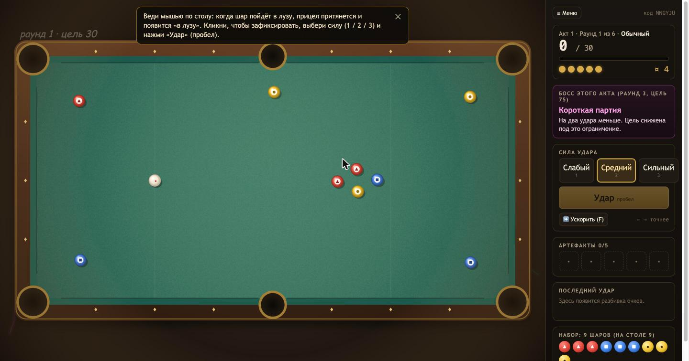

# Anomalous Pool (Аномальный пул)

A pool roguelike. You pot coloured balls for points with a limited number of shots, and between rounds you collect artifacts that turn one shot into a chain reaction.

[](https://iansilent.github.io/anomalous-pool/)

**[▶ Play in the browser](https://iansilent.github.io/anomalous-pool/)** · mouse or touch · UI in Russian

## The idea being tested

Does the "build a scoring engine" loop of a deckbuilder work when the hand you play is a physical pool shot?

- A round has a target score and a few shots. Colour combos and trick shots (banks, combinations, potting several balls) multiply the score.
- After a round you pick a reward and visit a shop: artifacts and ball properties that reward one way of playing, such as single strong shots, bank shots or even potting the cue ball.
- An act is three rounds, and the third is a boss with a rule that breaks your habits.
- The setting is an underground club where the anomalies grow from act to act.

Every run has a code, and the same code gives the same run.

## Controls

| Action | Mouse / touch | Keys |
|---|---|---|
| Aim | Move over the table; the aim snaps to a pot when one is possible. Click to lock it | ← → turn by 0.1°, Shift + ← → by 1° |
| Power | Three buttons | 1 / 2 / 3 |
| Strike | «Удар» | Space |
| Speed up | ⏩ | F |
| Menu | ≡ | Esc |

## What is inside

- [docs/design-ru.md](docs/design-ru.md): the full design document (in Russian).
- `src/config.js`: every number in one place — targets, prices, multipliers, physics.
- A fixed-step physics simulation, so the aim preview and the real shot always agree.

## Run locally

Plain HTML, CSS and JavaScript on a canvas. No build step and no dependencies. Open `index.html`. Progress is saved in the browser.

## Checks

Rule checks plus a greedy bot that plays whole runs headlessly:

```bash
node tools/check.js
```
